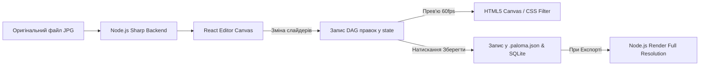

# 02. Екран редагування фото (Editor View)

Модуль редагування **Paloma** забезпечує **неруйнівну обробку зображень (Non-Destructive Editing)**. Усі зміни застосовуються у вигляді параметричних фільтрів на клієнтському HTML5 Canvas / CSS, а підсумковий рендеринг у високій роздільності здійснюється на Node.js за допомогою бібліотеки `sharp`.

---

## 📐 Архітектура екрана редактора

```
+-----------------------------------------------------------------------------------------+
| [ ⬅️ Назад до бібліотеки ]   IMG_0042.JPG (4000x3000)   [ ↩️ Скасувати ] [ 🔁 Повторити ] |
+------------------------------------+----------------------------------------------------+
| ПАНЕЛЬ ІНСТРУМЕНТІВ (LEFT TABS)    | ОБЛАСТЬ РЕДАГУВАННЯ ТА ПЕРЕГЛЯДУ                   |
|                                    |                                                    |
| [🔧 Базові] [☀️ Світло] [🎨 Ефекти] |  +----------------------------------------------+  |
|                                    |  |                                              |  |
| ▼ Базові корекції                  |  |                <EditorCanvas />              |  |
|  [ ✂️ Кадрування (Crop) ]           |  |                                              |  |
|  [ 📐 Вирівнювання горизонту ]      |  |             [ Живе прев'ю WebGL ]           |  |
|  [ 👁️ Червоні очі ]                |  |                                              |  |
|  [ 🪄 Авто-колір ]                 |  +----------------------------------------------+  |
|                                    |                                                    |
| ▼ Настройка світла (Tuning)        | РЕЖИМИ ПОРІВНЯННЯ:                                 |
|  Заповнення світлом --O--          | [ 🖼️ Одне фото ] [ 🌓 До / Після (Side-by-Side) ]   |
+------------------------------------+----------------------------------------------------+
| ПІДДОН: [ 💾 Зберегти оригінал ] [ 📤 Експортувати копію ] [ 🔄 Скинути до оригіналу ]    |
+-----------------------------------------------------------------------------------------+
```

---

## 🛠 Набір інструментів та вкладок редагування

### Вкладка 1: 🔧 Базові корекції (Basic Fixes)
1. **Кадрування (`<CropTool />`):**
   * Допоміжна сітка з фіксованими пропорціями: `16:9`, `4:3`, `10x15 см`, `Вільний вибір`.
   * Зручні великі кутові маркери для перетягування.
2. **Вирівнювання горизонту (`<StraightenTool />`):**
   * Інтерактивна слайдер-лінійка (-45° до +45°) з авто-сіткою.
3. **Усунення ефекту «червоних очей» (`<RedEyeTool />`):**
   * Клік по зіниці для автоматичної десатурації червоного спектра в радіусі.
4. **Автоматична корекція (`<AutoColorBtn />`):**
   * Нормалізація гістограми контрасту та балансу білого в один клік.

---

### Вкладка 2: ☀️ Точна настройка (Tuning & Light)
* **Fill Light (Заповнення тіней):** Висвітлення темних ділянок без пересвіту яскравих зон.
* **Highlights (Світлі тони):** Відновлення деталей на пересвічених хмарах або обличчях.
* **Shadows (Глибина тіней):** Регулювання насиченості темних тонів.
* **Color Temperature (Колірна температура):** Зсув спектра від холодного синього до теплого оранжевого.

---

### Вкладка 3: 🎨 Ефекти та стилізація (Effects)
* **Сепія (Sepia):** Надання фотографії теплого ретро-відтінку.
* **Чорно-біле (B&W / Monochrome):** Конверсія в монохром з налаштуванням червоного/зеленого фільтра.
* **Чіткість (Sharpen):** Підвищення контурної чіткості для старих розмитих знімків.
* **Віньєтування (Vignette):** М'яке затемнення країв кадру.

---

## ⚙️ Технічний пайплайн неруйнівного редагування



1. **Client Live Preview (Frontend):** Усі переміщення слайдерів миттєво розраховуються на `HTML5 Canvas` або через CSS WebGL шейдери (60 кадрів/сек).
2. **Збереження стану (Metadata DAG):** Масив застосованих дій зберігається в локальній БД SQLite та файлі `.paloma.json`:
   ```json
   {
     "photo": "IMG_0042.jpg",
     "edits": [
       { "type": "crop", "rect": [10, 15, 800, 600] },
       { "type": "straighten", "angle": 2.5 },
       { "type": "tuning", "fillLight": 20, "temperature": 5500 }
     ]
   }
   ```
3. **Full-Res Render (Backend):** Під час підтвердження збереження або експорту Node.js приймає об'єкт `edits` і застосовує відповідні операції бібліотеки `sharp` до оригінального файлу.

---

## ♿ Senior-Friendly UI для Екрана Редагування

* **Великі слайдери:** Товщина лінійки слайдера `12px` з великим круглим ползунком `32px`.
* **Кнопка «Показати оригінал»:** Утримування кнопки з миттєвим показом вхідного фото для порівняння.
* **Необмежене скасування (Unlimited Undo):** Проста кнопка «Крок назад» без ризику втратити оригінальне фото.
