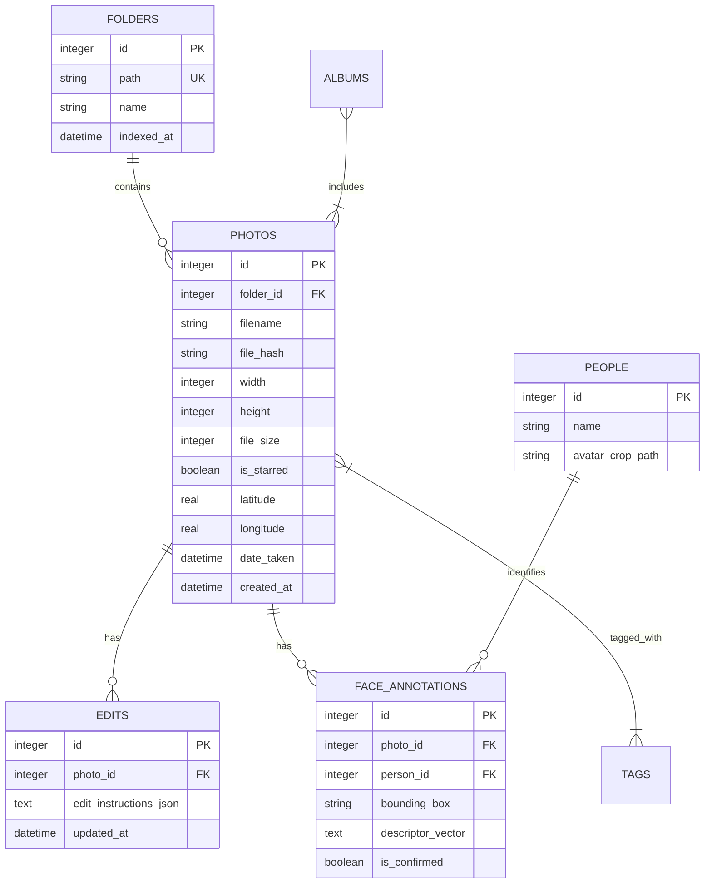

# 06. Збереження, метадані та схема SQLite (Storage & Metadata)

Цей розділ описує архітектуру зберігання даних, структуру бази даних **SQLite**, використання сайдкар-файлів `.paloma.json` та роботу з метаданими (EXIF / IPTC / XMP).

---

## 💾 1. Архітектурний принцип зберігання даних

Paloma дотримується трьох фундаментальних правил зберігання:
1. **Безпека оригіналів:** Вхідний файл фотографії **ніколи не перезаписується** без явного підтвердження користувача. При збереженні оригінал копіюється у приховану підпапку `.paloma/originals/`.
2. **Сайдкар-файл `.paloma.json`:** У кожній каталогізованій папці з фотографіями створюється локальний JSON-файл із метаданими, підписами та історією правок. Це забезпечує легку переносимість архіву між комп'ютерами.
3. **Швидкодіюча локальна база SQLite:** База даних виконує роль глобального кешу та індексу для миттєвого пошуку, фільтрації та швидкого завантаження списків без повторного сканування файлової системи.

---

## 🗄️ 2. Схема реляційної бази даних SQLite

Схема розроблена для керування через `better-sqlite3` або `drizzle-orm`.



---

## 📄 3. Формат сайдкар-файлу `.paloma.json`

Файл створюється в кожній папці з фотографіями (сучасна альтернатива застарілому `.picasa.ini`):

```json
{
  "version": "1.0",
  "folder_name": "2024_Відпустка_Карпати",
  "photos": {
    "IMG_0042.jpg": {
      "is_starred": true,
      "caption": "Захід сонця на полонині",
      "tags": ["Карпати", "Гори", "Відпустка"],
      "geo": {
        "latitude": 48.155,
        "longitude": 24.520
      },
      "edits": {
        "crop": [100, 100, 1920, 1080],
        "straighten": 1.5,
        "tuning": {
          "fillLight": 15,
          "temperature": 5600
        }
      },
      "faces": [
        {
          "box": [120, 80, 200, 200],
          "person_name": "Бабуся Олена",
          "confirmed": true
        }
      ]
    }
  }
}
```

---

## 🏷️ 4. Обробка EXIF / IPTC / XMP метаданих

* **Зчитування:** При виявленні нового файлу модуль Node.js використовує `exiftool-vendored` або `exif-reader` для витягування:
  * Дата та час зйомки (`DateTimeOriginal`).
  * Параметри камери (ISO, апертура, витримка, фокусна відстань).
  * Координати GPS.
  * Орієнтація кадру (Auto-rotation EXIF orientation).
* **Запис метаданих:** За бажанням користувача (наприклад, при експорті) нові теги, підписи та геолокаційні мітки записуються безпосередньо у відповідні EXIF/IPTC блоки знімка.
